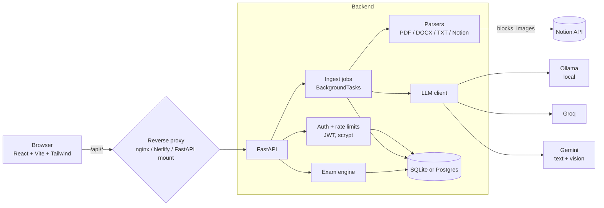

# Quizloom

Turn your own study material (PDF, Word, text notes, Notion pages) into a question bank and take timed practice exams. Built for CIPP/E, CISSP and similar certifications.

> **Disclaimer:** independent study aid, not affiliated with IAPP or ISC2. Questions are AI-generated and can be wrong; verify against official materials. Not legal advice.

**Try it:** click *Try the demo* on the login page (shared, read-only account with a sample CIPP/E bank).

## Features

- **Sources:** PDF / DOCX / TXT upload, Notion page URL (sub-pages followed, optional image reading via Gemini vision), or generate from a topic.
- **LLM providers:** local Ollama, Groq (free tier), Google Gemini (free tier). Keys are entered in the UI.
- **Background generation** with live progress, per-chunk failure reporting and a clear done / partial / failed result.
- **Exams:** pick labels, number of questions and a countdown timer; one question at a time; score and full review with explanations.
- **Accounts:** username/password (scrypt + JWT); every user's labels, questions and exams are isolated.
- **Guard rails:** per-IP / per-user rate limits, upload size cap, SSRF-guarded image fetching, read-only demo account.

## Architecture



**Generation flow:** source → parse into paragraph-sized chunks (150–2500 chars) → for each chunk ask the LLM for 1–3 MCQs as JSON → validate → store under the user's label. Progress and errors are tracked per job and polled by the UI.

```
quizloom/
  backend/    FastAPI app, routers/ (auth, upload, questions, exam), services/ (llm, notion, parsers, auth, ratelimit, demo), seed/
  frontend/   React SPA (pages/, components/, api/)
  Dockerfile  single-container build for Hugging Face Spaces
  docker-compose.yml, netlify.toml, railway.toml
```

## Run locally

**Docker (backend + nginx frontend, Ollama on the host):**

```bash
cp .env.example .env     # set JWT_SECRET
docker compose up -d --build
# app at http://localhost:3000
```

**Without Docker:**

```bash
cd backend && python -m venv venv && source venv/bin/activate
pip install -r requirements.txt && uvicorn main:app --reload     # :8000
cd frontend && npm install && npm run dev                         # :5173
```

Optional local LLM: install [Ollama](https://ollama.com) and `ollama pull gemma3:4b`. On CPU it is slow; Groq or Gemini free tiers are much faster.

## Configuration

| Variable | Default | Purpose |
|---|---|---|
| `JWT_SECRET` | dev value | **Set a long random string in production** |
| `DATABASE_URL` | `sqlite:///./examprep.db` | Use a Postgres URL for persistence on free hosts |
| `ALLOWED_ORIGINS` | `http://localhost:5173` | CORS (comma-separated) when frontend is on another origin |
| `DISABLE_OLLAMA` | off | Hide Ollama (cloud deployments) |
| `DEMO_ENABLED` | `true` | Seed the read-only `demo` account and show the demo button |
| `MAX_UPLOAD_MB` | `10` | Upload size cap |
| `RATE_LIMIT_ENABLED` | `true` | Signup 5/h/IP, login 10/5min/IP, generation 30/h/user |
| `NOTION_MAX_PAGES` | `50` | Cap on Notion pages followed per import |
| `SSL_VERIFY` | `true` | Set `false` only behind a TLS-intercepting corporate proxy (local dev) |
| `OLLAMA_BASE_URL` | `http://localhost:11434` | Ollama endpoint |

## Deploy

**Render (single container, free, no card):** push to GitHub, create a Render *Web Service* from the repo (runtime Docker, root `Dockerfile`, free instance). Set `JWT_SECRET` and `DATABASE_URL` (free Postgres, e.g. Neon) as environment variables. The free instance sleeps after ~15 min idle. The same image works on Google Cloud Run and on Hugging Face Docker Spaces (paid).

**Railway (backend) + Netlify (frontend):** deploy `backend/` on Railway with a volume at `/data` and `DATABASE_URL=sqlite:////data/examprep.db`; deploy the frontend on Netlify with `BACKEND_URL` pointing at Railway (see `netlify.toml`, `railway.toml`).

## Privacy and security notes

- Imported text (and, with image reading, images) is sent to the LLM provider you choose; Groq and Gemini process it under their own terms. Uploaded files are deleted after parsing.
- LLM and Notion keys are stored only in the user's browser (localStorage) and sent per request; the server keeps them in memory for the duration of a job and does not persist or log them.
- Passwords are salted scrypt hashes; tokens are signed JWTs (7 days).
- Rate limiting is in-memory and per process; it trusts `X-Forwarded-For`. Use a real gateway or Redis for anything larger.
- See the in-app **Privacy & disclaimer** page.

## Limitations

- Question quality depends on the model; there is no automatic answer verification yet.
- Notion databases and linked pages are not followed; PDFs/DOCX are text-only (no OCR or image reading).
- No automated tests yet; parser and isolation tests are the next step.
